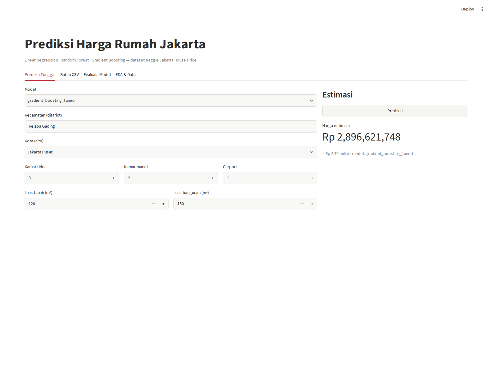
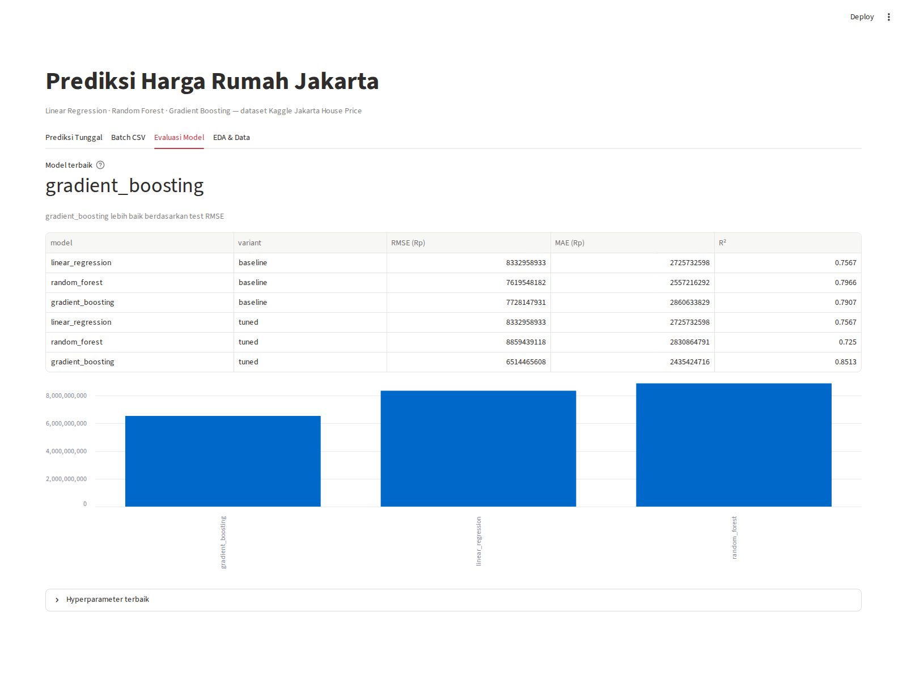
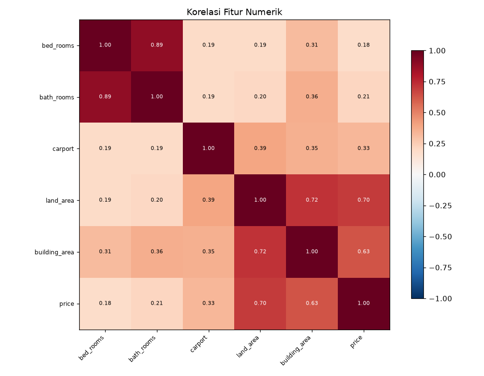

# House Price Prediction — Jakarta

Regression project on Kaggle dataset `abiyyurasyiq/jakarta-house-price-dataset`
(10,000 rows; `index,price,district,city,bed_rooms,bath_rooms,carport,land_area,building_area`).

Compares Linear Regression, Random Forest, Gradient Boosting. Includes cleaning,
EDA, feature engineering, baseline + tuned evaluation, Streamlit and FastAPI apps.

## 1. Install

```bash
python3 -m venv .venv
.venv/bin/pip install -r requirements.txt
```

## 2. Get the real dataset (Kaggle)

Kaggle download needs a login token. No credentials were available in this
environment, so the CSV is NOT bundled. Two options:

**Option A — token** (Kaggle → Account → Create New API Token):
```bash
mkdir -p ~/.kaggle && cp /path/to/kaggle.json ~/.kaggle/ && chmod 600 ~/.kaggle/kaggle.json
.venv/bin/python download_data.py
```

**Option B — manual:** download `jakarta_house.csv` from
https://www.kaggle.com/datasets/abiyyurasyiq/jakarta-house-price-dataset
and put it at `data/jakarta_house.csv`.

Optional: `.venv/bin/pip install kaggle` (only needed for Option A).

## 3. Run the pipeline

```bash
.venv/bin/python eda.py       # stats + charts -> outputs/figures/
.venv/bin/python train.py     # baseline + tuning -> outputs/models/, outputs/metrics.json
.venv/bin/python predict.py --file data/sample_input.csv -o outputs/predictions.csv
```

> STATUS: data asli Kaggle terpasang (`jakarta_house.csv`, 10,000 × 9,
> SHA256 `4f5e492e…617aa3aa`). Pipeline dijalankan ulang dengan data ini;
> angka di bawah berasal dari data asli. `make_stub.py` hanya dipakai saat
> validasi awal dan tidak diperlukan lagi.

## Hasil dengan data asli

| Model | Baseline RMSE / R² | Tuned RMSE / R² |
|---|---|---|
| Linear Regression | 8.333 M / 0.757 | 8.333 M / 0.757 |
| Random Forest | 7.620 M / 0.797 | 8.859 M / 0.725 |
| Gradient Boosting | 7.728 M / 0.791 | **6.514 M / 0.851** |

Pemenang: Gradient Boosting (huber, depth 6, lr 0.05, subsample 0.85,
400 trees, min_samples_leaf 1). CV log-RMSE 0.3967.

`loss="huber"` memberi lonjakan terbesar: 0.4131 → 0.4048 log-RMSE
di CV train. Data punya outlier harga yang tetap resisten sesudah clipping;
huber tidak mengejar residual ekstrem itu.

Yang sudah diuji tapi **tidak** dipakai:
- Target encoding `district`/`city`, OOF benar (nested CV): 0.423–0.424 —
  kalah dari one-hot 0.413. Versi tanpa OOF yang pernah memberi R² 0.83 itu
  leakage (encode di-fit sebelum CV split).
- Stacking GB+RF: test R² 0.825, kalah dari GB tunggal 0.851.
- `HistGradientBoostingRegressor`: 0.425–0.431 — kalah dari GB klasik 0.405
  (dataset kecil, 10k baris; histogram binning tidak membantu).
- Interaksi fitur (`land_x_bed`, `build_x_bath`, `bed_minus_bath`,
  `area_per_room`): GB naik hanya 0.3978→0.3970 (dalam noise, std 0.0045
  antar 5 seed), tapi linear regression runtuh 0.757→0.315 karena range
  fitur meledak. Dibuang — tugas butuh 3 algoritma sehat.
- RF tuning: 0.725, lebih buruk dari baseline 0.797; RF disimpan sebagai model
  baseline untuk perbandingan.

Keputusan model final: GB + `loss="huber"`. Ini satu-satunya perubahan setelah
bug duplikat yang memberi lonjakan nyata (>2σ antar seed). Sisanya noise.

10,000 baris dari 10,000. `index` adalah ID listing — 526 baris punya fitur
identik tapi harga berbeda, jadi `drop_duplicates()` tidak dipakai di `clean()`.
Target di-clip ke kuantil 0.1%/99.9% (`cap_price()` di data.py); tanpa clipping
CV log-RMSE 0.436–0.447 vs 0.413–0.418 dengan clipping.

## 4. Apps

```bash
.venv/bin/streamlit run streamlit_app.py          # http://localhost:8501
.venv/bin/python fastapi_app.py                   # http://localhost:8000/docs
```

### Tampilan aplikasi Streamlit

Halaman utama — prediksi tunggal:



Tab Evaluasi Model — metrik baseline vs tuned:



Heatmap korelasi fitur numerik (dihasilkan `eda.py`):



FastAPI example:
```bash
curl -X POST http://localhost:8000/predict -H 'Content-Type: application/json' -d \
 '{"district":"Kelapa Gading","city":"Jakarta Utara","bed_rooms":3,"bath_rooms":2,"carport":1,"land_area":120,"building_area":150}'
```

## Pipeline

- Cleaning: numeric coercion, `price<=0` dan null-target dibuang, `bed/bath=0`
  → NaN lalu median impute, sentinel kategorikal → `Unknown`. `index` adalah ID
  listing, jadi `drop_duplicates()` sengaja tidak dipakai.
  Target di-clip kuantil 0.1%/99.9% (`cap_price()`).
- Log target `log1p(price)` for training; `expm1` back to Rupiah on prediction.
- Feature engineering: `building_to_land_ratio`, `total_rooms`, `room_density`,
  `land_per_room`, `bath_per_bed`, `log_land_area`, `log_building_area`.
  (`district_target_encode()` in data.py provides leakage-safe ordinal encoding
  as an optional alternative to one-hot; not used in the default pipeline.)
- Split: 80/20 seeded, 5-fold CV on TRAIN for tuning; test touched once.
- Metrics: RMSE, MAE, R² on Rupiah scale. Winner by test RMSE.

## Layout

```
download_data.py   Kaggle API downloader
data.py            shared cleaning + feature engineering (single source of truth)
eda.py             EDA statistics and figures
train.py           baseline + RandomizedSearchCV tuning + artifacts
predict.py         CLI batch scoring from CSV
streamlit_app.py   single + batch UI
fastapi_app.py     /predict, /batch/predict, /models, /health
requirements.txt
outputs/           generated: models, figures, metrics.json, predictions.csv
```

Data source: Kaggle `abiyyurasyiq/jakarta-house-price-dataset` (MIT license).
